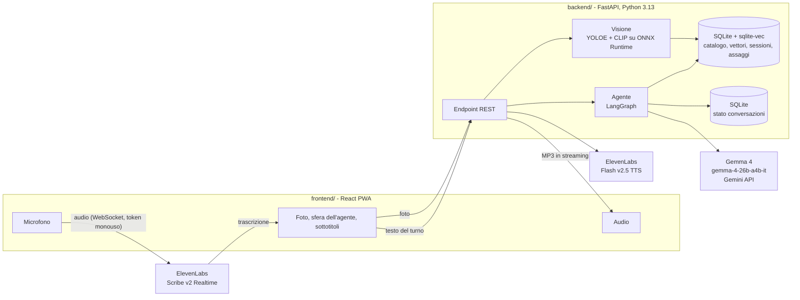
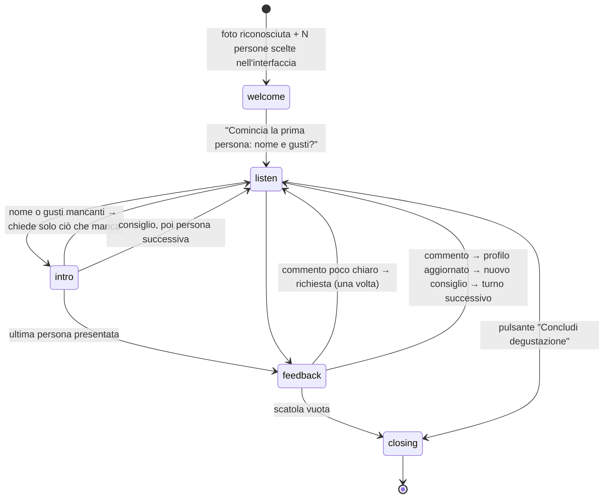

# GemmaCacao: architettura

Come funziona GemmaCacao dietro le quinte. Per l'introduzione e l'avvio vedi il [README](README.md).

## Stack tecnologico

### Backend (`backend/`, Python 3.13, gestito con uv)

| Area | Libreria | Versione | Uso |
|---|---|---|---|
| API REST | FastAPI + Uvicorn | 0.162 / 0.54 | endpoint, streaming audio, file statici |
| Configurazione | pydantic, pydantic-settings, python-dotenv | 2.14 / 2.16 | validazione dei dati, variabili `APP_*`, chiavi dai file `.env` |
| Agente | LangGraph + langgraph-checkpoint-sqlite | 1.2 / 3.1 | macchina a stati della conversazione, stato salvato su SQLite |
| LLM | google-genai (Gemini API) | 2.33 | Gemma 4 `gemma-4-26b-a4b-it` con output JSON validato |
| Voce | elevenlabs | 2.74 | token monouso per la trascrizione, sintesi vocale in streaming |
| Visione | onnxruntime | 1.31 | rilevatore YOLOE esportato in ONNX, su CPU |
| Embedding | fastembed | 0.9 | OpenAI CLIP ViT-B/32 (ONNX) per immagini e testi |
| Database | SQLite + sqlite-vec + aiosqlite | 0.1.9 / 0.22 | catalogo, sessioni, assaggi e ricerca vettoriale |
| Immagini | Pillow, NumPy | 12.3 / 2.5 | ritagli e preprocessing |
| Qualità | pytest + pytest-asyncio, ruff | 9.1 / 0.17 | test e lint |

PyTorch e Ultralytics **non** servono a runtime: stanno nel gruppo opzionale `export` (`uv run --group export`) e si usano solo per riesportare il rilevatore in ONNX.

### Frontend (`frontend/`, TypeScript)

| Area | Libreria | Versione | Uso |
|---|---|---|---|
| UI | React + React DOM | 19.3 | interfaccia a passi |
| Build | Vite + @vitejs/plugin-react | 8.3 / 6.1 | dev server con proxy verso il backend, build |
| PWA | vite-plugin-pwa | 2.0 | manifest, service worker, installazione sul telefono |
| Voce | @elevenlabs/react (`useScribe`) | 1.19 | microfono verso Scribe v2 Realtime, con rilevamento di fine frase |
| Qualità | TypeScript, oxlint | 6.0 / 1.89 | controllo dei tipi e lint |

### Servizi esterni

| Servizio | Modello | Ruolo |
|---|---|---|
| Google Gemini API | `gemma-4-26b-a4b-it` (MoE, circa 4B parametri attivi), `thinking_level="minimal"` | capisce le risposte e formula i consigli |
| ElevenLabs Speech-to-Text | `scribe_v2_realtime` | trascrizione in italiano dal microfono, in tempo reale |
| ElevenLabs Text-to-Speech | `eleven_flash_v2_5`, voce italiana | voce del maître, in streaming MP3 |

## Panoramica



## 1. Riconoscimento della scatola

| Passo | Cosa succede | Tecnologia |
|---|---|---|
| Conteggio | Un riquadro per ogni dolcetto. Il modello prompt-free trova oggetti generici; un filtro geometrico (NMS senza classi, esclusione di contenitori e decorazioni, filtro sulle dimensioni) tiene un riquadro per dolcetto. | YOLOE `yoloe-26s-seg-pf` esportato in ONNX, CPU |
| Ritaglio | Ogni riquadro diventa un'immagine singola, con un piccolo margine. | Pillow |
| Embedding | Ogni ritaglio diventa un vettore a 512 dimensioni. | OpenAI CLIP ViT-B/32 (ONNX, via `fastembed`) |
| Confronto | Ricerca dei vicini più simili tra le foto dei dolcetti del negozio (peso 80%) e le loro descrizioni (peso 20%). | `sqlite-vec`, tabelle partizionate per negozio |
| Assegnazione | Assegnazione globale: in una scatola assortita ogni prodotto compare una volta. | algoritmo greedy |

Risultato sulla foto demo: 16 dolcetti su 16, riconosciuti correttamente anche con la foto ruotata e più scura. Tempo totale circa 1,2 secondi sulla CPU, senza GPU.

## 2. Conversazione

L'agente è una macchina a stati LangGraph. **Il codice decide il flusso**: a chi tocca, quali dolcetti sono liberi, quando la scatola è finita. **Gemma si occupa del linguaggio**: capisce le risposte, estrae nome, gusti, allergie e voto, e formula i consigli con tono gioviale.



- **Turni**: ogni risposta dell'utente è un `interrupt` di LangGraph. Il backend riprende il grafo con il testo trascritto. Lo stato è salvato su SQLite: anche ricaricando la pagina la conversazione riprende.
- **Memoria della persona**: le frasi della stessa persona si sommano (`notes`). Un "Mi chiamo Luca" detto dopo si unisce ai gusti detti prima.
- **Robustezza**:
  - Le chiamate a Gemma sono ridondate: se una è lenta ne parte una seconda in parallelo, se fallisce viene sostituita, entro 20 s.
  - Se una API key supera i limiti (429) si passa alla chiave di riserva `GOOGLE_API_KEY_FALLBACK`.
  - Oltre, un piano B a regole (`agent/rules.py`) capisce nome, gusti, allergie e voto, e la conversazione va avanti.
  - Il nome si chiede al massimo 3 volte (poi "Ospite N"), i gusti e i commenti poco chiari una volta sola: il flusso non si blocca mai.
- **Sicurezza dei consigli**: se Gemma propone un dolcetto non disponibile, o che contiene un allergene dichiarato, il codice lo sostituisce con una scelta calcolata sui gusti della persona.
- **Gemma 4**: `gemma-4-26b-a4b-it` con `thinking_level="minimal"` arriva al primo token in circa 1 secondo e chiude la risposta in circa 2 (con l'API in buona salute). L'output è JSON validato con Pydantic, tramite `response_json_schema`, perché `response_schema` con Gemma restituisce errore 500.

## 3. Voce

| Direzione | Come |
|---|---|
| Utente → agente | Il browser invia il microfono direttamente a **ElevenLabs Scribe v2 Realtime**, con un token monouso fornito dal backend: la API key non lascia mai il server. Il rilevamento di fine frase (VAD) chiude il turno. Un breve tempo di grazia evita di tagliare chi fa una pausa. Le parole chiave della scatola (nomi dei dolcetti e dei partecipanti) migliorano la trascrizione. Se la connessione cade, il browser riprova una volta da solo. |
| Agente → utente | Il backend sintetizza la risposta con **ElevenLabs Flash v2.5** (voce italiana) e la manda al browser in streaming MP3: la riproduzione parte mentre l'audio è ancora in generazione. Il volume anima la sfera dell'agente. |
| Comandi | **Parla**: tocca per ascoltare, tieni premuto per push-to-talk. **Stop**: zittisce l'agente o chiude subito il turno. **Scrivi**: risposta da tastiera. **Concludi degustazione**: chiude con un ringraziamento e il riepilogo parziale. |

## API REST

| Metodo | Endpoint | Scopo |
|---|---|---|
| `GET` | `/api/shops/{slug}` | nome e logo del negozio (lo slug arriva dal QR code: `/s/{slug}`) |
| `POST` | `/api/sessions` | apre una sessione di degustazione |
| `POST` | `/api/sessions/{id}/photo` | foto della scatola → dolcetti contati e riconosciuti |
| `POST` | `/api/sessions/{id}/conversation/start` | `{group_size}` → primo messaggio dell'agente |
| `POST` | `/api/sessions/{id}/conversation/turn` | risposta dell'utente → risposta dell'agente e stato aggiornato |
| `POST` | `/api/sessions/{id}/conversation/end` | conclude subito: ringraziamento e riepilogo parziale |
| `GET` | `/api/sessions/{id}/conversation` | stato attuale (partecipanti, dolcetti, chi deve parlare) |
| `POST` | `/api/voice/stt-token` | token monouso per Scribe Realtime |
| `GET` | `/api/speech/{id}` | audio MP3 della risposta, in streaming |
| `POST` | `/api/client-log` | eventi del browser (microfono, trascrizioni, audio) nel log del server |

Documentazione interattiva su <http://127.0.0.1:8000/docs>.

## Log

Tutto finisce in `backend/logs/app.log` (a rotazione, 5 MB × 4):
- **richieste HTTP** con i tempi di risposta;
- **turni**: cosa è stato trascritto, la risposta dell'agente, i passaggi di fase, i dolcetti mangiati;
- **Gemma**: latenza, token e JSON restituito; richieste ridondate, errori, cambio di chiave, uso del piano B;
- **riconoscimento**: dolcetti trovati con codice e punteggio;
- **TTS**: tempo al primo byte, dimensione, errori ElevenLabs;
- **browser**: connessione del microfono, trascrizioni ricevute, ritardo prima che parta l'audio, errori.

```bash
tail -f backend/logs/app.log
```

## Scelte tecniche

| Scelta | Motivo |
|---|---|
| Gemma 4 via Gemini API | Gemma 26B o 31B non entrano negli 8 GB di VRAM del PC della demo. Il 31B sull'API dava errori 500 e risposte da 20–50 secondi. |
| Niente PyTorch a runtime | YOLO e CLIP girano su ONNX Runtime: ambiente da circa 350 MB invece di circa 6 GB. |
| YOLOE prompt-free | con prompt testuali ("chocolate") trovava 4–13 dolcetti su 16. Le sue etichette vengono ignorate: a identificare i dolcetti è CLIP. |
| SQLite + `sqlite-vec` | un solo file, zero infrastruttura. Il passaggio a Postgres + pgvector è diretto. |
| Turni deterministici, LLM per il linguaggio | il flusso resta prevedibile e testabile; Gemma non può "perdere il filo". |
| PWA (vite-plugin-pwa) | installabile sul telefono, si apre a schermo intero dal QR code. |

## Struttura del progetto

```
backend/
  app/
    main.py            avvio FastAPI, caricamento modelli e grafo
    api.py             endpoint REST
    config.py          configurazione (variabili APP_*, chiavi Google)
    db.py              SQLite + sqlite-vec
    voice.py           ElevenLabs: token STT, TTS in streaming
    logging_setup.py   log su console e su file a rotazione
    agent/             LangGraph: stato, grafo, prompt, client Gemma, regole di riserva
    vision/            detector ONNX, embedder CLIP, riconoscimento
  scripts/             seed_catalog.py, export_detector.py
  data/seed/demo/      catalogo e logo del negozio demo
  models/              yoloe-26s-seg-pf.onnx
  tests/
frontend/
  src/
    App.tsx            passi: foto → riconoscimento → quanti siete → degustazione → riepilogo
    hooks/useTastingVoice.ts   ciclo voce: parla, ascolta, invia
    components/        Orb, PhotoStep, BoxView, PeopleStep, Tasting, ProfileToast, Summary
    log.ts             invio degli eventi del browser al log del server
img/                   foto e descrizioni della scatola demo
```
