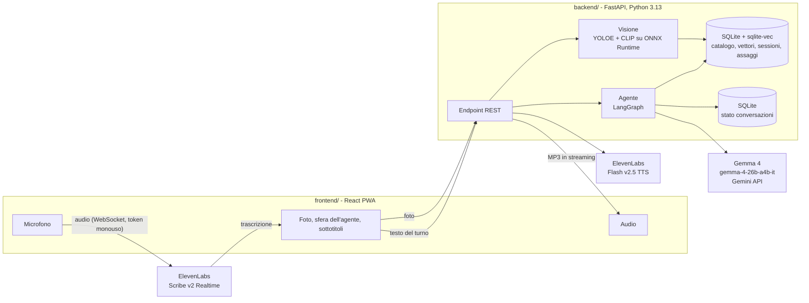
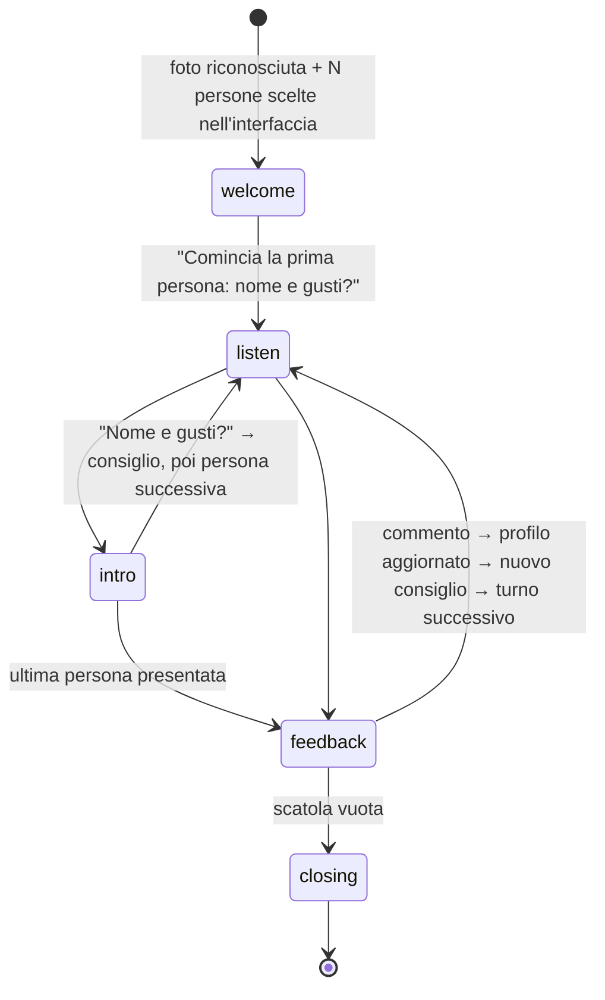

# GemmaCacao 🍫

**Il maître chocolatier che ti guida, a voce, nella degustazione della tua scatola di cioccolatini.**

## Cos'è

Una cioccolateria spedisce a casa una scatola di cioccolatini. Dentro c'è un QR code: inquadrandolo con il telefono si apre GemmaCacao, una piccola app web che trasforma l'apertura della scatola in un'esperienza guidata.

1. **Fai una foto** alla scatola aperta, dall'alto.
2. GemmaCacao **conta i dolcetti** e **riconosce** quali sono, confrontandoli con il catalogo del negozio.
3. Indichi **quanti siete** con un contatore.
4. Inizia la **degustazione a voce**: il maître conosce una persona alla volta (nome e gusti preferiti) e consiglia a ciascuno il dolcetto più adatto, spiegando perché. La foto della scatola resta in alto e mostra chi sta assaggiando cosa.
5. Dopo l'assaggio chiede a ognuno, chiamandolo per nome, com'era. Impara dai commenti, aggiorna il profilo di gusto di ogni persona (lo vedi salvare sullo schermo) e propone il dolcetto successivo.
6. Si continua così finché la scatola è vuota. Alla fine compare un **riepilogo a schede**: per ogni persona i dolcetti assaggiati, i voti, il preferito e i gusti che il maître ha capito.

Si parla come con una persona: niente moduli da compilare. Se c'è rumore si può tenere premuto il pulsante per parlare, oppure scrivere la risposta.

Per il negozio è anche un modo per sapere cosa piace davvero ai clienti: ogni commento viene registrato.

---

## Architettura

### Panoramica



### 1. Riconoscimento della scatola

| Passo | Cosa succede | Tecnologia |
|---|---|---|
| Conteggio | Un riquadro per ogni dolcetto. Il modello prompt-free trova oggetti generici; un filtro geometrico scarta scatola, decorazioni e doppioni. | YOLOE `yoloe-26s-seg-pf` esportato in ONNX, CPU |
| Ritaglio | Ogni riquadro diventa un'immagine singola, con un piccolo margine. | Pillow |
| Embedding | Ogni ritaglio diventa un vettore a 512 dimensioni. | OpenAI CLIP ViT-B/32 (ONNX, via `fastembed`) |
| Confronto | Ricerca dei vicini più simili tra le foto dei dolcetti del negozio (peso 80%) e le loro descrizioni (peso 20%). | `sqlite-vec`, tabelle partizionate per negozio |
| Assegnazione | Assegnazione globale: in una scatola assortita ogni prodotto compare una volta. | algoritmo greedy |

Risultato sulla foto demo: 16 dolcetti su 16, riconosciuti correttamente anche con la foto ruotata e più scura. Tempo totale circa 1,2 secondi sulla CPU, senza GPU.

### 2. Conversazione

L'agente è una macchina a stati LangGraph. **Il codice decide il flusso**: a chi tocca, quali dolcetti sono liberi, quando la scatola è finita. **Gemma si occupa del linguaggio**: capisce le risposte, estrae nome, gusti, allergie e voto, e formula i consigli.



- **Turni**: ogni risposta dell'utente è un `interrupt` di LangGraph. Il backend riprende il grafo con il testo trascritto. Lo stato è salvato su SQLite: anche ricaricando la pagina la conversazione riprende.
- **Robustezza**: le chiamate a Gemma sono ridondate (se una è lenta ne parte una seconda in parallelo, se fallisce viene sostituita) entro 20 s; se una API key supera i limiti (429) si passa alla chiave di riserva `GOOGLE_API_KEY_FALLBACK`; oltre, un piano B a regole capisce nome, gusti, allergie e voto e la conversazione va avanti. Il nome si chiede al massimo 3 volte (poi "Ospite N"), i gusti e i commenti poco chiari una volta sola: il flusso non si blocca mai.
- **Sicurezza dei consigli**: se Gemma propone un dolcetto non disponibile, o che contiene un allergene dichiarato, il codice lo sostituisce con una scelta calcolata sui gusti della persona.
- **Gemma 4**: si usa `gemma-4-26b-a4b-it`, un modello MoE con circa 4 miliardi di parametri attivi. Con `thinking_level="minimal"` arriva al primo token in circa 1 secondo e chiude la risposta in circa 2. L'output è JSON validato con Pydantic, tramite `response_json_schema`.

### 3. Voce

| Direzione | Come |
|---|---|
| Utente → agente | Il browser invia il microfono direttamente a **ElevenLabs Scribe v2 Realtime**, con un token monouso fornito dal backend: la API key non lascia mai il server. Il rilevamento di fine frase (VAD) chiude il turno. Un breve tempo di grazia evita di tagliare chi fa una pausa. Le parole chiave della scatola (nomi dei dolcetti e dei partecipanti) migliorano la trascrizione. |
| Agente → utente | Il backend sintetizza la risposta con **ElevenLabs Flash v2.5** (voce italiana) e la manda al browser in streaming MP3: la riproduzione parte mentre l'audio è ancora in generazione. Il volume anima la sfera dell'agente. |
| Comandi | **Parla**: tocca per ascoltare, tieni premuto per push-to-talk. **Stop**: zittisce l'agente o chiude subito il turno. **Scrivi**: risposta da tastiera. |

### API REST

| Metodo | Endpoint | Scopo |
|---|---|---|
| `GET` | `/api/shops/{slug}` | nome e logo del negozio (lo slug arriva dal QR code: `/s/{slug}`) |
| `POST` | `/api/sessions` | apre una sessione di degustazione |
| `POST` | `/api/sessions/{id}/photo` | foto della scatola → dolcetti contati e riconosciuti |
| `POST` | `/api/sessions/{id}/conversation/start` | `{group_size}` → primo messaggio dell'agente |
| `POST` | `/api/sessions/{id}/conversation/turn` | risposta dell'utente → risposta dell'agente e stato aggiornato |
| `POST` | `/api/sessions/{id}/conversation/end` | conclude subito (pulsante demo): ringraziamento e riepilogo parziale |
| `GET` | `/api/sessions/{id}/conversation` | stato attuale (partecipanti, dolcetti, chi deve parlare) |
| `POST` | `/api/voice/stt-token` | token monouso per Scribe Realtime |
| `GET` | `/api/speech/{id}` | audio MP3 della risposta, in streaming |
| `POST` | `/api/client-log` | eventi del browser (microfono, trascrizioni, audio) nel log del server |

Documentazione interattiva su <http://127.0.0.1:8000/docs>.

### Log

Tutto finisce in `backend/logs/app.log` (a rotazione, 5 MB × 4):
- **richieste HTTP** con i tempi di risposta;
- **turni**: cosa è stato trascritto, la risposta dell'agente, i passaggi di fase, i dolcetti mangiati;
- **Gemma**: latenza, token e JSON restituito; errori e tentativi;
- **riconoscimento**: dolcetti trovati con codice e punteggio;
- **TTS**: tempo al primo byte, dimensione, errori ElevenLabs;
- **browser**: connessione del microfono, trascrizioni ricevute, ritardo prima che parta l'audio, errori.

```bash
tail -f backend/logs/app.log
```

### Scelte tecniche

| Scelta | Motivo |
|---|---|
| Gemma 4 via Gemini API | Gemma 26B o 31B non entrano negli 8 GB di VRAM del PC della demo. Il 31B sull'API dava errori 500 e risposte da 20–50 secondi. |
| Niente PyTorch a runtime | YOLO e CLIP girano su ONNX Runtime: ambiente da circa 350 MB invece di circa 6 GB. PyTorch serve solo per riesportare il detector (`uv run --group export`). |
| YOLOE prompt-free | con prompt testuali ("chocolate") trovava 4–13 dolcetti su 16. Le sue etichette vengono ignorate: a identificare i dolcetti è CLIP. |
| SQLite + `sqlite-vec` | un solo file, zero infrastruttura. Il passaggio a Postgres + pgvector è diretto. |
| PWA (vite-plugin-pwa) | installabile sul telefono, si apre a schermo intero dal QR code. |

### Struttura del progetto

```
backend/
  app/
    main.py            avvio FastAPI, caricamento modelli e grafo
    api.py             endpoint REST
    config.py          configurazione (variabili APP_*)
    db.py              SQLite + sqlite-vec
    voice.py           ElevenLabs: token STT, TTS in streaming
    agent/             LangGraph: stato, grafo, prompt, client Gemma
    vision/            detector ONNX, embedder CLIP, riconoscimento
  scripts/             seed_catalog.py, export_detector.py
  data/seed/demo/      catalogo e logo del negozio demo
  models/              yoloe-26s-seg-pf.onnx
  tests/
frontend/
  src/
    App.tsx            passi: foto → riconoscimento → quanti siete → degustazione → riepilogo
    hooks/useTastingVoice.ts   ciclo voce: parla, ascolta, invia
    components/        Orb, PhotoStep, BoxView, PeopleStep, Tasting, ProfileToast, Summary
    log.ts             invio degli eventi del browser al log del server
img/                   foto e descrizioni della scatola demo
presentation/          slide di presentazione della demo (index.html autonomo)
```

---

## Come usarlo

**Prerequisiti:** [uv](https://docs.astral.sh/uv/), Node 20 o superiore, una key ElevenLabs e una key di Google AI Studio.

```bash
# 1. Chiavi (file esclusi da git)
npx -y @elevenlabs/cli@latest onboard init   # salva ELEVENLABS_API_KEY in .env.local
cp backend/.env.example backend/.env         # GOOGLE_API_KEY (+ opzionale GOOGLE_API_KEY_FALLBACK)

# 2. Installazione e catalogo demo
make setup

# 3. Avvio (backend su :8000, frontend su :5173)
make dev
```

Poi:

1. Apri <http://localhost:5173/s/demo>: è la pagina che aprirebbe il QR code.
2. Premi **Scatta una foto** e scegli `img/scatola_aperta.jpg`.
3. Premi **Avanti**, scegli quanti siete, poi **Inizia la degustazione** e rispondi a voce.
4. Per chiudere prima della fine, premi **Concludi degustazione**: il maître ringrazia e compare il riepilogo di quanto raccolto fino a lì.

Altri comandi: `make test` (test), `make lint` (controlli), `make seed` (ricarica il catalogo).

> Nomi, note di degustazione e allergeni del catalogo demo sono dati di esempio ricavati da `img/descrizioni_dolci.txt`: vanno verificati con la cioccolateria.

---

## Presentazione

In `presentation/index.html` ci sono le 5 slide che introducono la demo: copertina, problema, soluzione, architettura e passaggio alla demo live. È un unico file HTML, senza build né dipendenze.

```bash
open presentation/index.html        # macOS (su Linux: xdg-open)
```

| Tasto | Azione |
|---|---|
| `→` `↓` `Spazio` / clic a destra | slide successiva |
| `←` `↑` / clic a sinistra | slide precedente |
| `F` | schermo intero |
| `N` | mostra/nasconde le note per lo speaker |

L'indirizzo ricorda la slide aperta (`index.html#4` apre l'architettura). I font arrivano da Google Fonts: senza connessione le slide funzionano comunque, con Georgia e Arial al loro posto.
